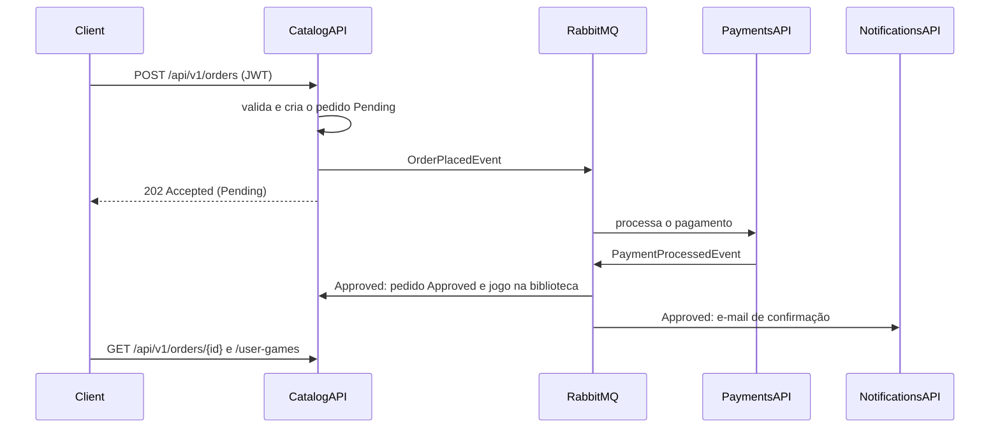

# FCG.CatalogAPI

Microsserviço de **catálogo** da FIAP Cloud Games (FCG), Fase 2. Faz o CRUD de jogos, **inicia a compra** (pedido) e mantém a **biblioteca** de jogos de cada usuário. A compra é assíncrona: o Catalog cria o pedido como `Pending`, publica o `OrderPlacedEvent` e só adiciona o jogo à biblioteca quando recebe o `PaymentProcessedEvent` aprovado.

## Papel no ecossistema



## Estrutura

```
01- API/FCG.Catalog.Api                         Controllers (Games, Orders, UserGames), validação JWT, Swagger, /health
02- Core/FCG.Catalog.Application                DTOs, validators, services (GameService, OrderService, UserGameService)
02- Core/FCG.Catalog.Domain                     Entidades (Game, Order, UserGame), OrderStatus, Result pattern, repositórios
03- Infrastructure/FCG.Catalog.Infrastructure   EF Core + Npgsql, migrations, repositórios, MassTransit (consumer e publisher), DI
05- Tests/FCG.Catalog.UnitTests                 Regras de negócio (pedido, idempotência, acesso, CRUD)
05- Tests/FCG.Catalog.IntegrationTests          API + PostgreSQL (Testcontainers) + MassTransit Test Harness
Contracts/Events.cs                             Contratos de integração (idênticos em todos os repositórios)
k8s/                                            Deployment, Service, ConfigMap, Secret, kustomization
Dockerfile                                      Build multi-stage, usuário não-root
```

O Catalog **não** chama o UsersAPI. O id, o e-mail e a role do usuário vêm das claims do JWT, validado com a mesma chave.

## Entidades e regras de negócio

| Entidade | Descrição |
|----------|-----------|
| `Game` | Nome (100), descrição (500), preço maior que 0 e soft delete |
| `Order` | Pedido com `UserId`, `UserEmail`, `GameId`, um snapshot de `GameName` e `Price`, o `Status` (`Pending`, `Approved` ou `Rejected`) e o `ProcessedAt` |
| `UserGame` | Item da biblioteca: usuário, jogo, `PricePaid`, `OrderId` de origem e data. O par (usuário, jogo) tem índice único |

**Compra (`POST /orders`)**

1. O jogo precisa existir.
2. O usuário não pode já possuir o jogo (409).
3. Não pode haver outro pedido `Pending` do mesmo usuário para o mesmo jogo (409).
4. O pedido nasce `Pending`, com o preço e o nome do jogo no momento da compra, e é salvo **antes** de o `OrderPlacedEvent` ser publicado.
5. A resposta é **202 Accepted**; o resultado é acompanhado em `GET /orders/{id}`.

**Resultado do pagamento (consumer `PaymentProcessedEvent`)**

- `Approved`: o pedido vira `Approved` e o jogo entra na biblioteca, com o pedido e a entrada salvos na mesma transação.
- `Rejected`: o pedido vira `Rejected`, a biblioteca não muda e o usuário pode tentar de novo.
- **Idempotência**: a transição só acontece a partir de `Pending`. Um evento repetido ou de um pedido inexistente é ignorado, e o índice único impede duplicidade na biblioteca.

**Acesso**

- O CRUD de jogos é exclusivo do administrador; listar e consultar jogos é permitido a qualquer usuário autenticado.
- O usuário comum vê só os próprios pedidos e a própria biblioteca; o administrador vê tudo e pode filtrar por `userId`.

## Endpoints

Todas as rotas exigem JWT. Swagger em `/swagger`.

| Método | Rota | Acesso | Descrição |
|--------|------|--------|-----------|
| POST | `/api/v1/games` | Admin | Cria um jogo (201) |
| GET | `/api/v1/games` | Autenticado | Lista (filtros `value`, `minPrice`, `maxPrice`, paginação) |
| GET | `/api/v1/games/{id}` | Autenticado | Detalhe do jogo |
| PUT | `/api/v1/games/{id}` | Admin | Atualiza |
| DELETE | `/api/v1/games/{id}` | Admin | Soft delete |
| POST | `/api/v1/orders` | Autenticado | Inicia a compra e publica `OrderPlacedEvent` (202) |
| GET | `/api/v1/orders` | Próprio ou Admin | Lista os pedidos (filtros `userId`, `gameId`, `status`) |
| GET | `/api/v1/orders/{id}` | Dono ou Admin | Status do pedido |
| GET | `/api/v1/user-games` | Próprio ou Admin | Biblioteca (filtros `userId`, `gameId`, `purchasedFrom`, `purchasedTo`) |
| GET | `/api/v1/user-games/{id}` | Dono ou Admin | Item da biblioteca |
| GET | `/health` e `/health/live` | Anônimo | Readiness (inclui o banco) e liveness |

**Criar um pedido**

```http
POST /api/v1/orders
Authorization: Bearer <token>
{ "gameId": 1 }
```

```json
{ "value": { "id": 1, "userId": 2, "userEmail": "player@fcg.com", "gameId": 1, "gameName": "Hollow Knight", "price": 59.90, "status": "Pending", "createdAt": "...", "processedAt": null }, "success": true }
```

## Eventos

| Direção | Evento | Payload | Quando |
|---------|--------|---------|--------|
| Publica | `OrderPlacedEvent` | `OrderId`, `UserId`, `UserEmail`, `GameId`, `GameName`, `Price` | Após criar o pedido `Pending` |
| Consome | `PaymentProcessedEvent` | `OrderId`, `UserId`, `UserEmail`, `GameId`, `GameName`, `Price`, `Status` | Fila `catalog-payment-processed` |

## Configuração

| Variável | Origem no k8s | Padrão local |
|----------|---------------|--------------|
| `ConnectionStrings__DbConnection` | Secret | `Host=localhost;Port=5434;Database=fcg_catalog;Username=postgres;Password=postgres` |
| `RabbitMq__Host` / `RabbitMq__VirtualHost` | ConfigMap | `localhost` / `/` |
| `RabbitMq__Username` / `RabbitMq__Password` | Secret | `fcg` / `fcg` |
| `RabbitMq__PaymentProcessedQueue` | ConfigMap | `catalog-payment-processed` |
| `TokenSettings__Issuer` / `TokenSettings__Audience` | ConfigMap | `FCG.Users` / `FCG.Client` |
| `TokenSettings__Key` | Secret | a mesma chave do UsersAPI |

O consumer usa retry de 3 tentativas com intervalo de 5s, e as migrations são aplicadas no startup.

## Como executar

**Local**

```powershell
cd ../FCG.Orchestration; docker compose up -d postgres rabbitmq
cd ../FCG.CatalogAPI; dotnet run --project "01- API/FCG.Catalog.Api"   # http://localhost:5102/swagger
```

O token é obtido no UsersAPI (`POST /api/v1/users/logins`). Os padrões do `appsettings.json` já apontam para a infraestrutura do compose.

**Docker**: `docker build -t fcg-catalog-api:latest .`

**Kubernetes**: `kubectl apply -k k8s` (ou `kubectl apply -f k8s/`), seguido de `kubectl get pods`. Pressupõe os Services `postgres` e `rabbitmq` no cluster. No Kind, rode antes `kind load docker-image fcg-catalog-api:latest`.

## Testes

```powershell
dotnet test --project "05- Tests/FCG.Catalog.UnitTests/FCG.Catalog.UnitTests.csproj"                # 43 execuções
dotnet test --project "05- Tests/FCG.Catalog.IntegrationTests/FCG.Catalog.IntegrationTests.csproj"  # 18 execuções, requer Docker
```

- **Unitários**: a máquina de estados do `Order`; as regras de compra (jogo inexistente, já possuído, pedido pendente, snapshot de preço, publicação depois de salvar); o resultado do pagamento (Approved, Rejected, duplicado, pedido inexistente, sem duplicar a biblioteca); as regras de acesso e o CRUD com validações.
- **Integração**: CRUD via HTTP com o token de admin. `POST /orders` deixa o pedido `Pending` e publica o `OrderPlacedEvent`. O `PaymentProcessedEvent` injetado pelo harness, Approved ou Rejected, reflete no pedido e na biblioteca. Também cobre o evento duplicado, a recompra e os códigos 401, 403 e 409.

O detalhamento está em [`05- Tests/TESTS.md`](05-%20Tests/TESTS.md).
